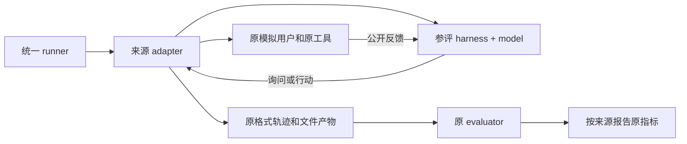

# NovOurs：原生环境下的意图推断 pilot

实现依据：Notion「11月初受控pilot study设计」，包含11月9日新增方法与原型方案。`docs/notion-spec.md` 保存所依据的原文。这里的任务、用户与评分来自原始来源；旧 `ours/` 实验保持独立。

```text
                ┌──────────────────────────┐
公开请求/历史 ──→│ Agent adapter             │
                │ Python / JSONL / HTTP     │
                │ harness + model + memory  │
                └────────────┬─────────────┘
                             │ 问询 / 回应 / 原工具
                ┌────────────▼─────────────┐
                │ 来源环境                  │
                │ 原用户模拟 + 工具 + 生命周期│
                └────────────┬─────────────┘
                             │ 原生轨迹与产物
                ┌────────────▼─────────────┐
                │ 原 evaluator + 原聚合     │
                └──────────────────────────┘
```



## 布局

- `novours/`：统一接口、方法、来源适配、传输与日志。
- `configs/`：不含密钥的可运行 smoke 配置。
- `tests/`：私有信息边界、依赖撤销、假想分支不污染真实历史、协议与工具能力测试。
- `docs/`：方案、方法边界、任务清单和实际验证结果。
- `.local/`：BBQCard2 的请求轨迹、模型输出、原生运行副本、检查点和上游方法依赖；Git 忽略。

## 在 BBQCard2 运行

从 `/home/tim/Proj/I3Agent` 执行。使用现有 `lifesim-venv` 或 Pi 的 `.venv-pibench311`，不修改原 conda `tim`。完整环境依赖仍由各来源管理。

```bash
bash NovOurs/launch_vllm.sh
# 另一个终端；现有凭据只在进程环境中读取
set -a
. ./deepseek.env.sh
set +a
export PYTHONPATH="$PWD/NovOurs"

lifesim-venv/bin/python -m novours inventory --output NovOurs/.local/inventory.json
lifesim-venv/bin/python -m novours run --config NovOurs/configs/smoke.json --output NovOurs/.local/runs/my-direct
lifesim-venv/bin/python -m novours run --config NovOurs/configs/lifesim-p3.json --output NovOurs/.local/runs/my-p3
.venv-pibench311/bin/python -m novours run --config NovOurs/configs/pi-native.json --output NovOurs/.local/runs/my-pi
bash NovOurs/setup_mempa.sh
NovOurs/.local/venv/bin/python -m novours run --config NovOurs/configs/mempa-native.json --output NovOurs/.local/runs/my-mempa
```

需要 STITCH-adapted 时先运行 `python NovOurs/setup_upstream.py` 下载锁定提交。运行 `PYTHONPATH=NovOurs python -m unittest discover -s NovOurs/tests -v` 验证契约。

Pi 工具和 MemPA 配置使用端口8012：`NOVOURS_GPU=1 NOVOURS_PORT=8012 bash NovOurs/launch_vllm.sh`。默认 Qwen 服务为32K上下文。MemPA 的 MCP 1.x、json-repair 仅安装到 `.local/venv`。

STITCH 官方流水线使用 `bash NovOurs/setup_stitch.sh` 与 `configs/lifesim-stitch-official.json`。逐轮导出已观察历史，运行原 description/scope/segment/event labels/turn notes/retrieval；采用上游支持的文件模式，不需 Qdrant 服务。Qwen 和本地 embedding 替换 provider，原筛选排序代码保留。`stitch` 是另行标注的轻量适配版。

`source` 可选 `lifesim/pi/mempa/proagent`；LifeSim 可选 `single_session/long_horizon`、固定 `sequence_id`、事件数与轮次；Pi 采用固定 `user_id/task_ids`；MemPA 采用固定 persona 与原 acc/probe安排。修改配置必须用新输出目录。已有完整结果可以 `--resume` 直接读取；不完整交互不会在污染的状态上盲目重跑。LifeSim 有原日志后可 `evaluate` 单独继续评分，已写完的 judge 文件复用。

## 外部 harness 协议

配置 `agent.method=process` 并给出 `command` 数组，或 `method=http` 与 `url`。两者接收相同 JSON RPC：`{version:1,id,method,params}`，返回 `{id,result}`；失败返回 `{id,error}`。JSONL 的 stdout 只能输出协议，日志写 stderr。HTTP endpoint 对每个 POST 返回 JSON。协议不要求每轮重建 harness。

Python 插件使用 `agent.method=python`、`factory=module:Class` 和 `options={...}`；类实现 `initialize/act/finish(payload)`。

MemPA 外部 harness 还需声明 `checkpoint_protocol=true`，实现 `checkpoint` 返回可序列化状态、`restore({checkpoint})` 恢复状态；否则拒绝运行，防止 probe 状态污染主线。内置 JSONL server 已支持这两个方法。

- `initialize`：session_id、公开 context、capabilities、原 tool schemas。
- `act`：公开 history/context、当前工具；返回 `{type,text,name,arguments,diagnostics}`。`name/arguments` 只对 tool；`diagnostics.intent` 是 LifeSim 的可选原评分字段。
- `finish`：结束本次会话。任务是否成功仍由来源环境与原 evaluator 决定。

LifeSim 不提供原任务没有的工具或等待能力。Pi 通过原工具 registry 执行工具。MemPA 的 controller 接在原 runner 内，必须遵守它原本的 IX 输出/工具契约；状态存入原 Session.metadata，probe 在原分支副本中运行。工具型 harness 不能读取环境私有目录，只有任务 workspace 与公开观测属于其输入。

## 评价与解释

四个来源不拼总分。运行日志统计耗时、token、内部调用和显式问询；这些不改变评分。LifeSim 自定义 harness 缺少 intent diagnostic 时原 IR 会把它当空预测，报告时必须说明覆盖率。MemPA 缩短 acc 的 smoke 不算完整长期实验，完整原评分需33个 probes；只完成一个session不得声称得到PSA/BRS/CS/PET。

具体哪些实现已试跑、哪些需资源与哪些方法是适配版本，见 `docs/results.md`、`docs/methods.md` 和 `modify.md`。新运行使用 DeepSeek 的许可只用于本目录试跑；原来的全轨迹分析 STOP 保留。

原生 LifeSim 评分聚合一致性：`PYTHONPATH=NovOurs lifesim-venv/bin/python NovOurs/verify_parity.py NovOurs/.local/runs/lifesim-native`。汇总所有成功和失败试跑：`PYTHONPATH=NovOurs lifesim-venv/bin/python NovOurs/report_runs.py`。

批量pilot使用 `pilot.py`，先冻结明确的任务配置与方法矩阵，再单独执行：

```bash
PYTHONPATH=NovOurs python3 NovOurs/pilot.py plan --plan NovOurs/.local/pilot-plan.json --configs NovOurs/configs/smoke.json NovOurs/configs/pi-tools-native.json NovOurs/configs/mempa-native.json --methods native direct p3
# plan不调用模型；检查每个config的任务/事件/acc范围后才运行
PYTHONPATH=NovOurs python3 NovOurs/pilot.py run --plan NovOurs/.local/pilot-plan.json --output NovOurs/.local/pilot
```

调度器按来源选择解释器，校验计划/配置散列，逐项写进度。完整结果可复用，失败或不完整交互保留并要求检查，不盲目重放。全量MemPA需将原配置 `acc_range` 设为 `1-108`、`score` 设为true，并留足超时；Pi应保留原任务依赖顺序，不能把依赖任务任意拆成独立样本。
