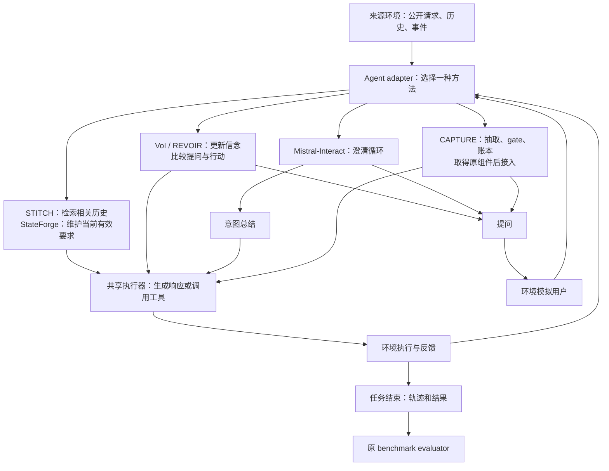
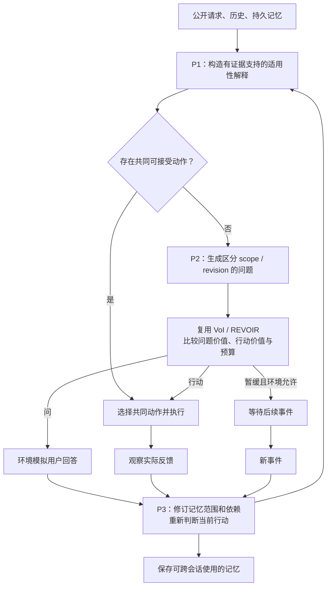

# Source specification snapshot

Source: https://www.notion.so/3ff200d7109280699628d1cf59d08625
Fetched: 2026-11-09. Section: 11月初受控pilot study设计 (including Nov 9 baseline/prototype additions).

<toggle heading="h2">
11月初受控pilot study设计

### 统一改造的benchmark

<b>目标：将 Pi-Bench、LifeSim、MemPABench、ProAgentBench 接到同一个环境入口，允许不同 harness + model 作为完整 agent 参加评测。统一情景表示和交互接口，评分全部沿用各原 benchmark。</b>

#### 1. 简化情景模型

每个情景表示为：

$$
s=(U,C,G)
$$

- $U$：用户信息，包括历史、偏好、习惯及已有变化记录。
- $C$：当前情境，包括正在发生的事件、当前任务、可用文件和工具。
- $G$：用户目标及本次任务约束。

Agent 接收初始可见材料和实际交互历史 $H_t$：

$$
o_t=\operatorname{Visible}(U,C,G,H_t),\qquad a_t=\pi_{h,m}(o_t)
$$

$h$ 表示 agent harness，$m$ 表示模型。记忆、检索、规划、意图推断和内部模型调用由 harness 自己管理。公式中的策略包含其内部状态，不要求每回合重新初始化。

对外动作统一为询问用户、提供帮助或执行、等待；任务结束用生命周期信号表示。具体可用工具和等待行为由来源环境提供，不给原任务新增不存在的能力。

#### 2. 环境中的模拟用户 agent

环境允许一个模拟用户 agent，依据 $U,C,G$ 和已经发生的对话回应被测 agent 的提问、方案及执行结果。

优先复用各来源已有的用户模拟逻辑，在外层统一接口。模拟用户获得用户侧材料，被测 agent 获得公开材料；原 benchmark 的信息披露顺序、会话边界和偏好变化安排继续保留。

模拟用户负责交互，原 benchmark 的 evaluator 负责评分。用户回复通过统一通道返回，不要求各 harness 使用相同的 prompt、记忆数据库或推理流程。

#### 3. 四个来源的接入方式

<b>Pi-Bench</b>

- 复用 profile、任务描述、隐藏需求、附件、工具及任务序列。
- 将现有用户模拟器和任务执行环境接到统一消息入口。
- NanoBot 保留为一种可替换的 agent 实现；ours 或其他 harness 通过同一入口运行。
- 沿用原有 PROC、COMP、checklist 和工具评分逻辑，保留原聚合方式。

<b>LifeSim</b>

- 复用 users、events、历史、偏好和意图相关材料。
- 保留生活事件、用户模拟及跨会话组织方式，将 assistant 调用替换为 agent adapter。
- 沿用原意图、偏好及对话相关评分实现和配置；评分需要的输出由适配器按原格式收集。

<b>MemPABench</b>

- 复用 persona、会话、偏好设置与变化、probe、状态 fixtures 和工具环境。
- 环境统一发送会话与探测任务；跨会话记忆的写入、组织和检索交给各 harness。
- 保留原会话与 probe 的记忆隔离、检查点和评测安排。
- 沿用原 probe、judge 和指标聚合实现。

<b>ProAgentBench</b>

- 使用材料齐全、能够按原 benchmark 评分的条目。
- 缺上下文、图像、标签、目标依据或原评分所需材料的条目直接跳过，不补造用户目标或 rubric。
- 按原任务类型接入已有数据和原评分流程；不强行将纯回放条目改为可干预世界。
- 若当前可用材料不能支撑某项原评分，则该部分暂不运行；先完成其他来源接入。
- 保存纳入与跳过的条目清单和原因，明确实际使用的子集。

#### 4. 统一接口与运行逻辑

采用“统一 runner + 来源环境 adapter + agent adapter + 原 evaluator”的结构。

运行流程：

1. Runner 根据来源和任务 ID 载入 $U,C,G$、公开材料、原工具及评分配置。
2. 创建该次运行独立的环境和模拟用户会话。
3. Agent adapter 把公开观测送入参评 harness。
4. Harness 自行决定提问、回应、工具操作或等待。
5. 来源环境执行工具或调度模拟用户，将反馈送回 harness。
6. 按原任务终止条件结束，保存完整对话、工具轨迹和结果产物。
7. Evaluation adapter 将记录转换成原评分器要求的格式，调用原 evaluator。
8. 按来源输出原指标及原聚合结果。

建议接口：

- Agent：初始化、接收事件、返回消息或动作、结束/保存会话。
- Environment：初始化任务、接收动作、返回用户/工具反馈、终止。
- Evaluator：接收原任务和转换后的轨迹，返回原指标。

接入同时支持 Python 和进程/HTTP 两种形式。Python 接口便于方法实验；进程/HTTP 接口便于保留现有 CLI、容器或远程 harness 的完整运行循环。适配层负责协议转换，策略逻辑留在参评 agent 内部。

#### 5. 评分原则

<b>所有评分沿用原 benchmark：保留原 rubric、标签、评分脚本、judge prompt、指标定义和聚合方式。</b>

- 不新增统一 rubric，不用现有 ours 的合成候选选择得分替代原评分。
- 工具任务继续使用原执行环境与原验收方式；对话任务继续按原对话标准评价。
- 原评分器需要的字段、工具轨迹和文件结果由 adapter 收集，保持字段语义。
- 四个来源分别报告原指标，不将不同指标硬合成一个新总分。
- 调用次数、token、耗时等作为运行日志记录，不加入新的评分公式。
- 使用筛选子集时报告来源版本和实际任务清单，方便各 harness 在完全相同的任务上比较。

#### 6. 实现方案与选择

<b>方案 A：统一包装原环境。</b> 各来源保留自己的用户、工具和评分器，通过统一 adapter 接入。改动集中在 agent 接入和轨迹格式转换，最适合当前实施。

<b>方案 B：全部重建为统一状态机。</b> 可以让所有运行细节一致，但需要重写事件与工具逻辑，工作量大。当前不采用。

<b>方案 C：统一 runner，逐步共享基础设施。</b> 先按方案 A 跑通，再共享消息协议、进程管理、日志、恢复和数据清单。来源特有的交互与评分仍保留。

<b>采用方案 A 起步，按方案 C 演进。</b> 统一入口和实验调度，保留各任务已有的语义与评分能力。

#### 7. 实验设计与实施顺序

研究对象是用户交互与意图推断策略，同时允许评测完整 harness + model。

- 策略比较：固定底层模型、来源任务、用户模拟配置和预算，比较不同交互/意图推断策略。
- 系统比较：接入不同完整 harness，记录模型与运行配置，按各来源原指标比较。
- 每个来源内部使用相同任务清单、初始状态、工具权限和会话安排；各方法的实际交互轨迹可以不同。
- 原 benchmark 中需要模型特定诊断输出的部分，在对应评分路径收集，不把内部推理格式强制成所有 harness 的共同架构。

实施顺序：

1. 整理四个来源的任务、用户材料、工具和评分入口；筛出 ProAgentBench 材料齐全的部分。
2. 定义统一事件、动作和任务生命周期接口，完成原环境包装。
3. 首先接入原生 agent 和一个不同 harness，打通任务—用户交互—工具—原评分闭环。
4. 用同一份原生轨迹对照 adapter 前后的评分，确认转换没有改变评分结果。
5. 接入 ours 与其他 baseline，开展同模型策略实验和完整系统实验。

<b>本节记录新的统一环境设计。此前的三阶段合成候选选择 pilot 保留在实验记录中，本次实现直接对接原任务与原评分。</b>

### Baseline 改造

设计记录：<date start="2026-11-09" />。已核对下列原文的方法章节与相关实现材料；代码可用性指已定位资源，尚未运行。当前仅定方案，不开始实现或实验。

<b>六组工作完整保留；主比较采用四个非训练方法，IN3 与 CAPTURE 单独注明训练依赖。</b>

1. <b>IN3 / Mistral-Interact</b> — [原文 §4.1–4.2](https://aclanthology.org/2024.acl-long.61.pdf)：训练意图澄清专家，先询问、再将总结交给执行 agent。<b>代码/权重已公开</b>：[仓库](https://github.com/thunlp/Tell_Me_More)、[checkpoint](https://huggingface.co/hbx/Mistral-Interact)。接入：将 <code>src/test_one.py</code> 的用户输入替换为环境用户接口，保留 inquiry→summary→executor。可直接用现成权重，但属于“无需新增训练”的补充系统比较，不列为同模型非训练方法。
2. <b>STITCH</b> — [原文 §2.1–2.3](https://arxiv.org/html/2601.10702v2)：scope、事件类型、实体信息组织历史，标签匹配后结合语义检索。<b>官方代码已公开</b>：[仓库](https://github.com/Seattleyrz/contextual-intent)。接入：可见历史→原标签/记忆流水线→<code>method_stitch/label_based_context_retrieval.py</code>→执行器上下文；保留原筛选与排序逻辑，替换下游任务与评分入口。
3. <b>CAPTURE</b> — [原文 §3、附录 B](https://arxiv.org/html/2609.02265v1)：抽取、真实性判别、记忆账本、澄清及审计；含 LoRA 抽取器和学习式 gate。<b>本轮未定位可下载官方代码/权重</b>，原文说明补充材料及后续公开计划。接入：取得组件后保留 extractor→gate→ledger/clarify→selector/audit。列为待资源补充项；提示词近似版不称为 CAPTURE。
4. <b>IntentFlux / StateForge</b> — [原文 §7，尤其 §7.2](https://arxiv.org/html/2609.32520v1)：IntentFlux 是 benchmark；StateForge 原始 harness 无需训练，维护有效要求、失效依赖及格式约束，蒸馏是另行实验。<b>未定位官方仓库</b>。接入：按论文重实现每轮状态更新、依赖失效、上下文注入和格式检查/重生成；标注“论文重实现”。
5. <b>VoI</b> — [原文 §4.1–4.2、式 1–5](https://arxiv.org/html/2601.06407v1)：比较提问后的预期行动收益与提问成本。<b>官方代码已公开</b>：[仓库](https://github.com/dong-river/VOI_communication)。接入：复用 <code>flight_rec/voi_utils.py</code> 的信念、假想回答、后验和净 VoI 选择；将写死的航班特征/三个动作泛化为来源任务的候选，内部效用估计不读取隐藏答案。
6. <b>REVOIR</b> — [原文 §3.1–3.3、附录 F/G/I/J](https://arxiv.org/html/2609.37588v1)：自然语言假设、回答预测、行动/提问价值比较与反馈更新。<b>未定位官方仓库</b>，原文有提示词与配置。接入：按论文重实现，保留假设更新、候选生成和价值评估；采用相应任务适用的 factored/incremental 配置。内部预测用户与环境真实模拟用户分开，纠正/终止能力跟随来源环境。

\*\*共同接入：\*\*优先共用 NanoBot 执行器，方法模块负责检索、状态更新、提问或行动决策；避免默认记忆整合与方法自有记忆重复生效。完整系统也可经独立 agent adapter 接入。匹配底层模型、可访问历史、工具、提问机会和推理预算；额外模型调用全部计入。

\*\*比较阵容：\*\*STITCH、StateForge、VoI、REVOIR 为主基线；增加 <b>StateForge + REVOIR</b>，可再加 <b>STITCH + REVOIR</b> 作为我们构造的组合强基线，检验收益是否超过简单拼接。IN3 用预训练权重单列，CAPTURE 待资源；旧 B1/B2/B3 仅作诊断对照。

#### 接入图：模块放在哪里

下图是我们的适配结构；六个 baseline 各自运行，只有显式命名的组合基线才串接两个方法。各方法内部循环按上述原文保留。

组合基线的串接方式：STITCH 的检索结果或 StateForge 的有效状态 → REVOIR 的信念与决策模块 → 共享执行器。此串接属于我们的组合实现。

#### VoI：什么时候值得问

用统一符号重述 [VoI §4.1–4.2](https://arxiv.org/html/2601.06407v1) 的单步决策，不作为 REVOIR 完整算法的替代：

$$
V(b)=\max_{a\in\mathcal A}\mathbb E_{\theta\sim b}[\hat u(a,\theta)],\qquad
\Delta(q)=\mathbb E_{y\sim p(\cdot\mid q,b)}[V(b^{q,y})]-V(b)-c(q)
$$

$b$ 是对用户偏好 $\theta$ 的信念；$\mathcal A$ 是可执行候选；$\hat u$ 是内部收益估计；$y$ 是预测回答；$b^{q,y}$ 是收到该回答后的信念；$c(q)$ 是提问成本。在预算允许时，若最大 $\Delta(q)>0$ 则问对应问题，否则按当前信念选行动。内部收益与最终原 benchmark 评分分开。REVOIR 还按原文评估行动后可能的纠正等后续反馈。

### 我们感兴趣的Prototype

\*\*待验证主张：\*\*根据证据持续判断“哪条历史偏好适用于当前请求”，允许修订，并据此行动、询问或暂缓。依据为 Harry 本轮来信：justified, revisable account of preference applicability。以下均为非训练候选原型，尚无实验结论。

1. \*\*P1：保留可修订的适用性解释。\*\*同时保留“长期默认 / 单次例外 / 其他情境”等有证据支持的解释，记录来源、适用范围、修订与行动依赖；新证据到来时更新解释并撤销受影响结论。验证：比 STITCH 检索、StateForge 单一有效状态更能处理模糊适用性，而非只检索最新纠正。
2. \*\*P2：询问历史规则的适用边界。\*\*生成区分解释的问题，例如“加预算只限上次活动，还是以后都采用？”，再复用 VoI/REVOIR 评估问题价值。验证：在相同证据与预算下，针对 scope/revision 的问题生成是否优于只问当前属性值；收益不归因于已有的 VoI 评分思想。
3. \*\*P3：解释—澄清—记忆修订闭环。\*\*组合 P1/P2，用户回答同时更新本次行动和后续会话的规则范围、依赖关系；存在共同可接受行动时直接执行，否则选问题，必要时使用原环境允许的暂缓。验证：跨会话原评分是否超过 StateForge + REVOIR，并减少同类误用的重复发生。

#### 原型的状态与闭环

以下是我们的设计记号，不是原文公式。$x_t$ 表示本轮公开请求及上下文，$H_t$ 表示可见历史，$M_t$ 表示持久记忆。P1 输出有证据支持的适用性解释集合：

$$
\mathcal Z_t=\operatorname{Explain}(M_t,H_t,x_t),\qquad
\widehat{\mathcal A}_{\cap,t}=\bigcap_{z\in\mathcal Z_t}\widehat{\mathcal A}_{\mathrm{ok}}(z,x_t)
$$

每个 $z$ 说明“哪条偏好为什么适用”，并关联来源、scope、revision 与依赖。$\widehat{\mathcal A}_{\mathrm{ok}}$ 是 agent 估计在该解释下可接受的候选动作，帽号表示估计而非隐藏真值。交集非空表示当前保留的解释允许共同动作；交集为空表示需继续比较提问、行动及环境允许的暂缓，不能仅凭交集为空强制提问。

P3 的更新可写为 $M_{t+1}=\operatorname{Revise}(M_t,e_t)$，其中 $e_t$ 是实际收到的回答或反馈；假想回答只用于决策评估，不直接写成用户事实。

<b>原型比较如何拆开：</b>P1 使用固定问题生成器与共同决策器，仅替换适用性表示；P2 固定输入证据与共同决策器，仅替换问题生成器；P3 开启 P1 + P2 及跨会话修订闭环。这样能分别判断收益来自状态表示、问题生成还是持续修订。

\*\*覆盖与诊断：\*\*在原数据中标记长期默认、单次例外、范围限定、撤销、其他情境的新纠正、证据不足；区分“偏好不确定但有共同可接受行动”与“必须澄清”。后者的按价值问/行动已被 VoI 覆盖，不单独作为新贡献。给定正确相关记录、给定真实当前状态仅用于诊断；分别消融 source、scope、revision 及 P1/P2。结合失败轨迹人工检查适用性判断。

\*\*评价与边界：\*\*四来源继续使用原 rubric、评分器及聚合；ProAgentBench 跳过缺材料条目。按来源报告原成绩及问题/推理预算，错误旧偏好使用和不必要提问只作轨迹诊断，不另造统一总分。本节只保存接入与原型设计，后续实施与实验另行启动。
