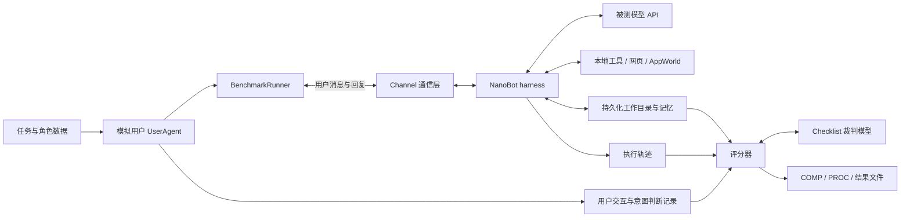
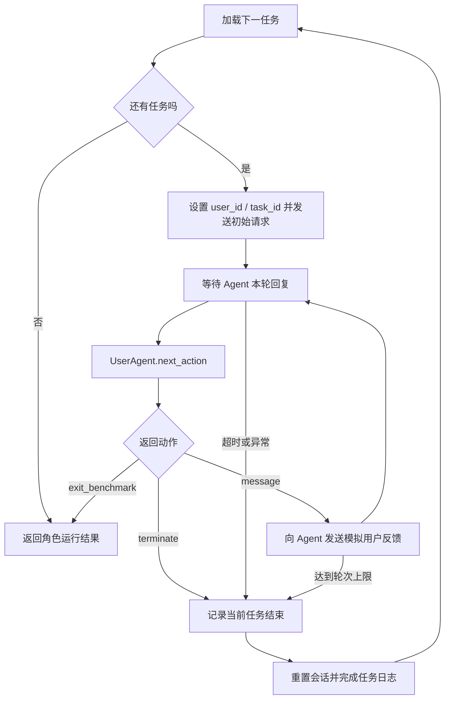
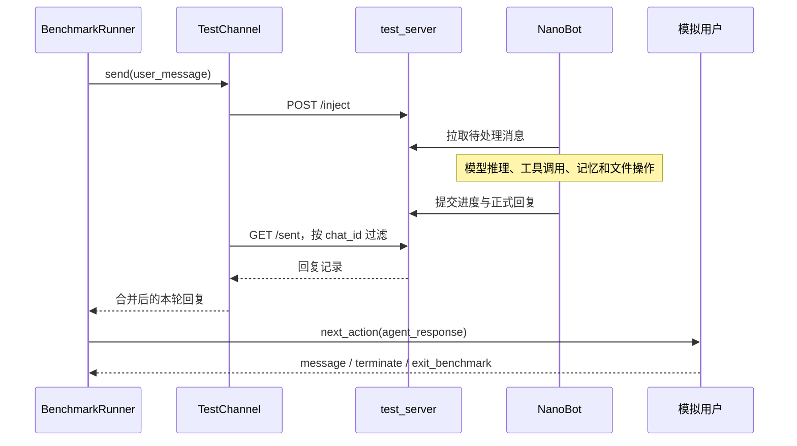
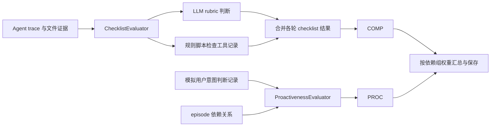

# Pi-Bench 代码运行逻辑与 harness 接入说明

本文介绍 Pi-Bench 如何启动实验、驱动多轮交互、调用工具和生成评分，以及如何将默认 NanoBot 替换为 I3Agent 等自定义 harness。

- 源码基线：`research/vendor/Pi-Bench`，commit `4f545be5d289b28ff022d2904d455007358ed3b7`。
- 文档位置：本地 I3Agent 项目根目录；文中的源码链接均相对此目录。
- 远端部署位置：BBQCard2 的 `/home/tim/Proj/I3Agent/Pi-Bench`。远端部署改动记录以该目录的 `modify.md` 为准。
- 本文的接口方案是设计建议，尚未在 Pi-Bench 中实现；本文不修改 benchmark 源码。

## 1. 评测对象：模型通过 harness 完成任务

Pi-Bench 包含 5 个角色、每个角色 20 个任务，共 100 个多轮任务。角色内部的任务具有偏好积累、文件传递和跨会话依赖，不能把它们简单当作 100 条独立问答。

默认被测系统是“模型 + NanoBot”。模型进行推理，NanoBot 提供执行循环、工具调用、记忆、技能和工作目录。评测器另外运行模拟用户，并在交互结束后评分。

论文主实验固定基于 NanoBot 的 scaffold，替换 9 个被测模型；模拟用户和 rubric 裁判使用 GPT-5.4。因此论文主结果主要比较统一 harness 下的模型能力，并没有进行不同 harness 的主结果对比。参见[论文实验设置](https://arxiv.org/html/2605.14678v1#S4.SS1)和[运行设置](https://arxiv.org/html/2605.14678v1#A4)。



这里有三个模型角色，可使用不同模型和 Key，也可共用一个接口：

- `model`：被测模型，由 NanoBot 调用。
- `user_agent`：模拟用户，生成反馈并判断隐藏意图是否被发现。
- `judger`：离线 checklist 评分使用的裁判。

共用一个模型适合初步跑通；比较实验时，应固定模拟用户、裁判及其配置。

## 2. 从命令到容器：外层负责启动，内层负责执行

入口定义在 [pyproject.toml](../sources/Pi-Bench/pyproject.toml)，`pibench` 指向 `src.main:cli_main`。需要区分两条调用路径：

- `pibench ...`：进入 Docker launcher，创建并管理实验容器。
- `python -m src.main ...`：进入实际运行程序，可执行 `run`、`eval`、`reeval`；另有生成运行配置的 `prepare-runtime` 子命令。

```text
┌───────────────────────────────────────────────────────┐
│ 宿主机：pibench --model-id <id>                         │
│ src/main.py → src/docker_launcher.py                  │
├───────────────────────────────────────────────────────┤
│ 读取角色与模型配置 → 构造角色 × 模型 × 重复次数的 jobs │
│ 检查 Docker / 镜像 → 创建各 job 的容器 → 监控并汇总   │
└──────────────────────────┬────────────────────────────┘
                           ↓
┌───────────────────────────────────────────────────────┐
│ 容器：scripts/entrypoint.sh                            │
├───────────────────────────────────────────────────────┤
│ 1. prepare-runtime：生成 benchmark 与 NanoBot 配置     │
│ 2. 启动 AppWorld API / MCP（启用时）                   │
│ 3. 启动 test_server 和 NanoBot gateway                 │
│ 4. python -m src.main --mode run：执行角色任务序列     │
│ 5. 对齐 trace 目录，--mode eval：评分                  │
│ 6. 输出日志、评分和运行状态                           │
└───────────────────────────────────────────────────────┘
```

源码入口：

- [main.py](../sources/Pi-Bench/src/main.py)：命令分流和参数。
- [docker_launcher.py](../sources/Pi-Bench/src/docker_launcher.py)：job 构建、容器创建、进程监控、分数汇总。
- [entrypoint.sh](../sources/Pi-Bench/scripts/entrypoint.sh)：容器内服务启动及 run → eval 顺序。
- [model_config.py](../sources/Pi-Bench/src/runtime/model_config.py)：将一份模型配置转成 benchmark 和 NanoBot 各自需要的配置。
- [example.full.yaml](../sources/Pi-Bench/config/models/example.full.yaml)：模型、用户、裁判、工具、运行参数的完整示例。

外层 launcher 启动多个 job 后统一轮询，因此不同角色、模型或重复实验可以并发；单个角色内部的任务由 runner 顺序执行。不能把模型配置里的 `max_concurrency` 直接解释为并行任务数，那是相应 LLM 客户端的请求并发限制。

`--run 3` 表示独立重复三次。`--rerun-failed` 根据已有运行状态复用完成的重复实验，不应当作任意中断点的逐轮恢复机制。

## 3. 数据组织：公开输入与隐藏意图分开

角色数据放在 `data/<role>/`，主要包括：

- `episode.yaml`：任务顺序和 `depends_on` 依赖。
- `tasks/<task_id>/task.yaml`：初始请求、隐藏意图和评测要求。
- 任务目录内的文件：PDF、CSV、Markdown、代码等工作材料。
- `scripts/`：部分任务的规则评分脚本。
- 角色相关的工具、技能配置和资源。

任务定义中最重要的字段是：

```text
task.yaml
├── intent.initial_input       → 被测 Agent 收到的初始请求
├── intent.hidden_intent       → 模拟用户和评分侧使用的隐藏要求
└── objectives
    ├── checklist              → 文本 / 产物验收条目
    ├── tools                  → 需要提取的工具证据配置
    └── tools_evaluation_path  → 规则评分脚本
```

模拟用户负责把必要信息通过后续对话逐步透露给 Agent。接入自定义 harness 时，应只暴露正常用户消息、任务资产和允许的环境资源，不能把完整 `task.yaml`、隐藏意图或评分脚本当作 Agent 输入。

有些任务主要建立用户偏好或给后续任务提供上下文，并没有独立 checklist。缺少 COMP 分数不等于这类任务运行失败；也不能因此将它们从完整 episode 中随意删除。

## 4. 多轮交互：runner 调度，模拟用户决定反馈

[runtime/app.py](../sources/Pi-Bench/src/runtime/app.py) 创建 Channel、UserAgent 和 BenchmarkRunner。默认 `build_channel()` 固定构造 `TestChannel`，不是通过通用插件注册表动态选择 harness。

[runner.py](../sources/Pi-Bench/src/runner/runner.py) 的主体逻辑如下：



`BenchmarkRunner` 的默认轮次上限是 30；每轮等待时间由运行配置传入。`SUCCESS` 表示交互协议正常结束，不意味着 checklist 全通过。`TIMEOUT`、`MAX_TURNS`、`ERROR` 等状态也应与任务分数分别查看。

模拟用户的 [next_action()](../sources/Pi-Bench/src/user_agent/user_agent.py) 不是简单的固定回复器：

1. 记录 Agent 回复，找出尚未透露或解决的隐藏意图。
2. 判断回复是否已经满足这些意图，记录相应 inferred 事件。
3. 对剩余意图，判断 Agent 是否进行了有针对性的追问。
4. 若存在针对性追问，回答对应问题；否则对尚未满足的要求生成补充反馈。
5. 根据协议决定继续还是终止。

模拟用户的部分判断还会读取任务指定文件的内容。因此文件接口不仅影响最终评分，也可能改变下一轮用户反馈。不能仅替换对话接口而忽略工作目录。

## 5. Channel：评测器与 NanoBot 的通信边界

[BaseChannel](../sources/Pi-Bench/src/channels/base.py) 已提供一层抽象：`connect()`、`disconnect()`、`send()`、`wait_for_reply()`、`reset()` 和 `set_runtime_identity()`。

默认 [TestChannel](../sources/Pi-Bench/src/channels/test.py) 使用 [test_server.py](../sources/Pi-Bench/scripts/test_server.py) 作为消息中转：



TestChannel 会暂存带 `_progress` 标记的进度，在收到非 progress 回复时合并交付。因此迁移时必须规定进度消息与正式用户轮次的关系，不能把内部每一步都算成用户交互轮次。

当前默认重置命令是 `/new`。它表示会话层面的重置，不能等同于删除整个角色的工作目录。对其他 harness 应显式定义会话结束、持久记忆保留和 episode 清理三种不同操作。

## 6. 工具执行与状态：NanoBot 执行，环境提供能力

```text
┌─────────────────────────────────────┐
│ NanoBot / 将来的自定义 harness       │
│ 规划 → 调用模型 → 执行工具 → 再推理  │
└───────────────┬─────────────────────┘
                │
      ┌─────────┼───────────────┐
      ↓         ↓               ↓
┌──────────┐ ┌───────────┐ ┌────────────────────┐
│ 本地工具 │ │ 网页工具  │ │ AppWorld MCP       │
│ 文件/exec│ │ search    │ │ → AppWorld API     │
│ 技能资源 │ │ fetch     │ │ → 模拟应用状态     │
└────┬─────┘ └─────┬─────┘ └──────────┬─────────┘
     ↓             ↓                ↓
 工作目录      外部网页资料      邮件/购物车/待办等
```

- `web_search` 默认依赖 Brave Search API Key；`web_fetch` 直接读取已知网址，不需要 Brave Key。
- AppWorld 提供 Gmail、Amazon、Todoist 等模拟应用，不需要用户真实外部账号。
- Docker 用于一致的执行环境；不是每一道题都会调用 AppWorld。
- 只有模型 API 并不能覆盖全部任务，仍需文件执行环境、网页能力和模拟应用数据。

一个完整 episode 应保留同一角色的工作文件及协议允许的记忆。不同角色、不同实验重复需要隔离，避免相互污染。

## 7. 评分：交互结束后读取轨迹和证据

[evaluation/runner.py](../sources/Pi-Bench/src/evaluation/runner.py) 组织评分。配置 `run.scoring` 可选 `checklist`、`proactiveness` 或 `both`。



### 7.1 COMP：不是严格的最终状态验收

[checklist_evaluator.py](../sources/Pi-Bench/src/evaluation/checklist_evaluator.py) 结合两类判断：

- LLM 根据轨迹和文件证据判断文本 checklist 条目。
- 任务脚本根据工具名、参数和结果检查结构化条件。

`_merge_turn_scores()` 对每个条目使用跨轮 `any(...)` 合并：某一轮通过，该条目可以最终记为通过。因此“中间做对，之后改坏”与只验收最终文件不是同一种语义。

只想关闭 PROC，可以配置：

```yaml
run:
  scoring: checklist
```

如果要严格只验收最终回答、最终文件和最终应用状态，需要另写结果采集与验收逻辑，同时处理带过程要求的条目以及没有独立结果标准的任务。创建后又删除临时项目这类任务，也不能只靠最终快照判断是否执行过。

### 7.2 PROC：基于隐藏意图覆盖和依赖关系

在本源码版本中，[proactiveness_evaluator.py](../sources/Pi-Bench/src/evaluation/proactiveness_evaluator.py) 汇总 inferred 和 targeted-followup matched 意图索引，去重后计算覆盖率，并在相关分数中纳入依赖任务的覆盖情况。

模拟用户主动补充了某个要求，并不自动等价于 Agent 主动发现该要求。评分需要保留它是如何被发现或透露的记录。

代码仍保留用户轮数、消息长度及 legacy score 等统计；不能仅看到这些字段，就认为当前主要 PROC 是按轮次长度惩罚计算的。应以当前 `average_score` 计算路径为准。

### 7.3 汇总和再评估

[overall_aggregation.py](../sources/Pi-Bench/src/evaluation/overall_aggregation.py) 使用依赖组大小作为权重。整体分数不能简单理解成 100 道题的无权平均；需要同时查看 `include_in_overall`、依赖组和权重等结果字段。

- `run`：产生交互与执行记录。
- `eval`：读取 trace、文件和意图记录进行评分。
- `reeval`：从已有 outputs 中重建/复用支持的评估信息，具体行为见 [reevaluation.py](../sources/Pi-Bench/src/evaluation/reevaluation.py)；不是重新执行 Agent，也不是任意新评分规则的通用入口。

运行记录、Agent trace 和评分结果用途不同。诊断失败时应同时检查退出状态、工具证据、最终文件和每项评分，而不是只看一个总分。

## 8. 剥离 NanoBot：可行，但要同时适配证据接口

现有解耦基础是 BaseChannel；仍然存在以下耦合：

- `runtime/app.py` 固定创建 TestChannel。
- `entrypoint.sh` 和 `model_config.py` 负责启动、生成 NanoBot 专用配置。
- 轨迹读取器依赖约定的目录、turn JSON 和字段结构。
- 部分规则脚本匹配具体工具名和返回结构。例如 [researcher_task_012_amazon.py](../sources/Pi-Bench/data/researcher/scripts/researcher_task_012_amazon.py) 检查 `mcp_appworld_amazon__add_product_to_cart` 和 `mcp_appworld_amazon__show_cart`。
- 模拟用户和评分器还依赖任务工作文件。

所以，只接通一个聊天 API 不足以完整兼容现有评测。建议把目标架构定义为：

```text
┌─────────────────────────────────────────────────────────────┐
│ Benchmark：任务顺序 / 模拟用户 / 隐藏意图 / 预算 / 裁判      │
└─────────────────────────────┬───────────────────────────────┘
                              │ 统一生命周期与消息协议
┌─────────────────────────────▼───────────────────────────────┐
│ Harness Adapter                                             │
│ start_episode / start_session / submit_user_message          │
│ stream_events / end_session / end_episode                    │
├──────────────────────┬──────────────────────┬───────────────┤
│ NanoBot adapter      │ I3Agent adapter      │ 其他 adapter  │
└──────────┬───────────┴──────────┬───────────┴───────┬───────┘
           └──────────────────────┼───────────────────┘
                                  ↓
┌─────────────────────────────────────────────────────────────┐
│ 公共环境：工作目录 / 网页 / AppWorld / 权限隔离              │
│ 环境侧审计：真实工具事件、产物快照、应用状态、资源使用       │
└─────────────────────────────┬───────────────────────────────┘
                              ↓
                   统一证据格式 → 评分器
```

以上方法名是建议接口，不是现成实现。接口语义应规定：

1. `start_episode`：为角色创建隔离环境，提供资源句柄及预算，不暴露隐藏答案。
2. `start_session`：开始一个任务，继承允许保留的工作目录与记忆。
3. `submit_user_message`：注入公开初始请求或模拟用户后续反馈。
4. `stream_events`：区分进度、正式回复、轮次结束、异常和资源统计；内部子 Agent 的消息不自动成为用户轮次。
5. `end_session`：采集证据并结束会话，不清空整个 episode。
6. `end_episode`：导出结果、结束后台活动并清理隔离环境。

统一证据应包含 episode/task/turn 标识、消息、工具事件 ID、操作标识、实际参数与结果、产物版本、时间和资源消耗。工具证据优先由环境侧生成，避免只依赖被测系统自报成功。无需要求不同 harness 暴露或采用同一种内部思维链。

对于后台主动行为，还应规定可执行的时间窗口及事件如何归属任务。原有交互协议以消息驱动为主，不能默认无限空闲时间内的主动工作也已得到公平评测。

## 9. I3Agent 接入的建议顺序

1. 先封装 NanoBot adapter，保留原有任务和评分语义。
2. 用同一批已有轨迹检查新旧证据转换、各条目分数和汇总结果一致；再做端到端回归。
3. 接入 I3Agent 的消息循环、持久化工作目录和公共工具环境。
4. 先测试本地文件、AppWorld 操作、跨任务依赖三类小样本，再运行完整 episode。
5. 固定模型、模拟用户、裁判及环境比较 NanoBot 与 I3Agent；同时报告时间、调用量和成本。
6. 如需要严格最终结果评分，另加独立指标并记录定义，避免同时更换 harness 和原版评分而无法归因。

只保留原版 COMP 与改造成最终状态评分是两种不同工作；支持自定义 harness 不要求先改变评分标准。

## 10. 推荐源码阅读顺序

1. [README.md](../sources/Pi-Bench/README.md)：整体运行方式。
2. [main.py](../sources/Pi-Bench/src/main.py) → [docker_launcher.py](../sources/Pi-Bench/src/docker_launcher.py) → [entrypoint.sh](../sources/Pi-Bench/scripts/entrypoint.sh)：启动链。
3. [runtime/app.py](../sources/Pi-Bench/src/runtime/app.py) → [runner.py](../sources/Pi-Bench/src/runner/runner.py)：对象装配和任务调度。
4. [user_agent.py](../sources/Pi-Bench/src/user_agent/user_agent.py)：多轮反馈与隐藏意图判断。
5. [base.py](../sources/Pi-Bench/src/channels/base.py) → [test.py](../sources/Pi-Bench/src/channels/test.py)：通信接口和现有 NanoBot 协议。
6. [trace_history.py](../sources/Pi-Bench/src/evaluation/trace_history.py) → [checklist_evaluator.py](../sources/Pi-Bench/src/evaluation/checklist_evaluator.py) → [proactiveness_evaluator.py](../sources/Pi-Bench/src/evaluation/proactiveness_evaluator.py)：证据构建和评分。
7. [overall_aggregation.py](../sources/Pi-Bench/src/evaluation/overall_aggregation.py)：依赖组与总分汇总。

Mermaid 图适合支持 Mermaid 的 Markdown 阅读器；框线图无需插件，也能在纯文本终端查看。
