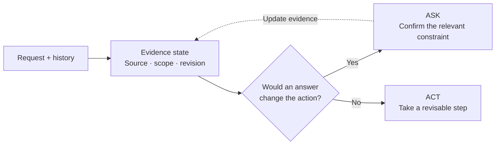
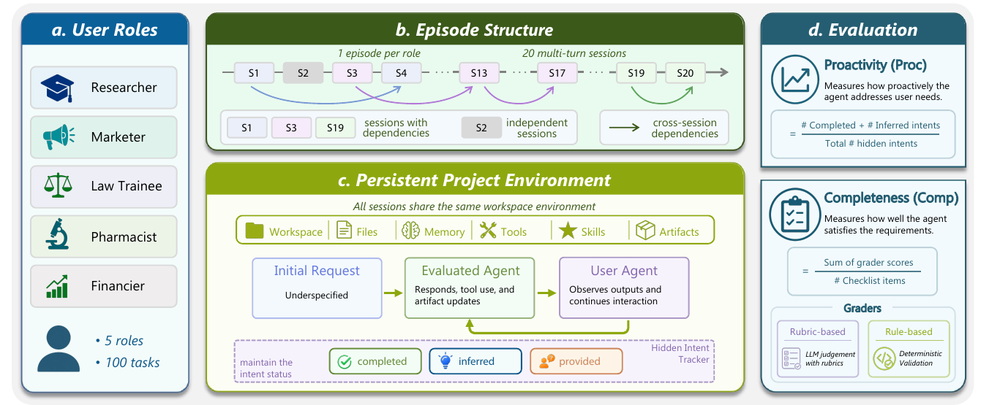

# I3Agent: When to Ask, and What to Ask

One-page research sketch · 26 October 2026

> Related work, research ideas, and experiment plans: [I3Agent project on Notion](https://www.notion.so/3ff200d7109280699628d1cf59d08625).

## 1. Narrow claim

**Hypothesis: tracking whether past preferences are confirmed, scoped, or revised improves task success at the same question budget**, compared with history retrieval and a memory-matched value-of-information (VoI) policy. Test the effect on question selection, beyond merely guarding actions.

*Proposed controller. Example: a past $50 budget + a special occasion → ask whether the cap still applies.*

## 2. Closest work & starting environment

*Original Figure 1, [Pi-Bench paper](https://arxiv.org/abs/2605.14678): 100 tasks, persistent workspaces, hidden intents; [code & data](https://github.com/Simplified-Reasoning/Pi-Bench).*

**Decision baselines:** [VoI](https://aclanthology.org/2026.acl-long.1987/), [REVOIR](https://arxiv.org/abs/2609.37588), [Steerable Clarification](https://arxiv.org/abs/2512.04068). **Closest state representation:** [Grounding Awareness](https://arxiv.org/abs/2610.18684). **Follow-ups:** [LifeSim code](https://github.com/sii-research/lifesim) for connected sessions; [PAST-Bench](https://github.com/Gen-Verse/PAST-Bench) for persistence controls.

## 3. Smallest controlled experiment

- **Setup:** reproduce one 20-task Pi-Bench sequence; construct 30 held-out checkpoints (10 each: sufficient evidence, missing fact, outdated/scoped preference).
- **Controls:** direct action, uncertainty threshold, memory-matched VoI, and our controller. Same model/history/tools; ≤1 atomic question. Scripted vs native users; three generation seeds.
- **Readout:** success, wrong assumptions, question/answer burden, and total compute. Pilot go/no-go: ≥10-point success gain over the strongest control at matched question count, no more consequential errors, consistent across user protocols. Report paired intervals.

## 4. Likely failure mode

**Simulator hacking:** native users volunteer unmet requirements. Audit disclosure and match compute. Give the true constraint as a diagnostic: persistent failure implicates execution. No training in the pilot; self-adaptation comes later.
