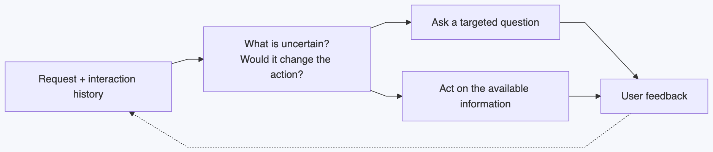
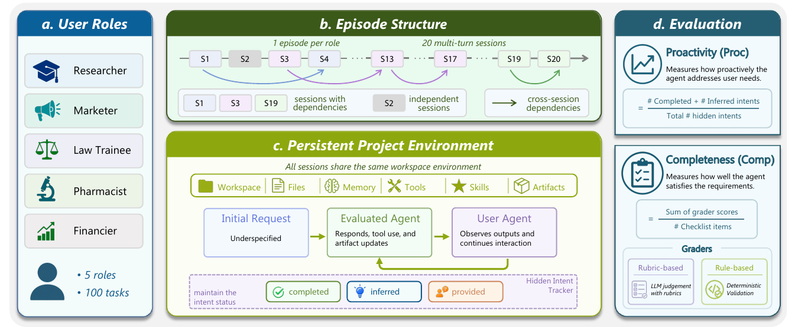

# On Long-Running Agent for User’s ImplicIt Intention Inference (I3Agent)

> I3Agent Project Online Update Page (Notion): https://www.notion.so/3ff200d7109280699628d1cf59d08625

## A. A Narrow Goal

**Build a proactive agentic personal AI assistant that knows when to ask and what to ask. (methodology contribution)**

**Working hypothesis.** Asking when an agent is uncertain could change the next action and improve task success over confidence-based questioning, at the same question and user burden.

## B. Related Source

**Environments and adaptation:** [π-Bench](https://github.com/Simplified-Reasoning/Pi-Bench) tests proactive tool use with hidden requirements; [LifeSim](https://github.com/sii-research/lifesim) simulates user intentions and preferences across conversations; [PAST-Bench](https://github.com/Gen-Verse/PAST-Bench) tests whether personal agents improve through retained experience.

**Recent baseline candidates:**

- [VoI](https://aclanthology.org/2026.acl-long.1987/) and [REVOIR](https://arxiv.org/abs/2609.37588): inference-time decisions about whether clarification is worth its cost.
- [Steerable Clarification](https://arxiv.org/abs/2512.04068): self-play training to choose between asking, guessing, and answering multiple interpretations under explicit costs.
- [Pareto-Dominant Clarification](https://arxiv.org/abs/2610.04089) (Oct. 2026): RL for coding accuracy under a question budget.
- [Learning to Clarify Underspecified Intents](https://arxiv.org/abs/2610.04719) (Oct. 2026): learning which questions best recover user utility in image generation.

*π-Bench overview ([original paper, Figure 1](https://arxiv.org/abs/2605.14678)).*

## C. Pilot Study

| Step | Smallest useful experiment |
|---|---|
| Reproduce | Run π-Bench tasks. |
| Inspect | Identify useful questions, unnecessary questions, and mistaken assumptions. |
| Compare | Retrieval-and-act, confidence-based questioning, and history-matched VoI. Test a targeted policy suggested by the analysis. |

Share the model, history, tools, and question budget. Measure **success, wrong assumptions, questions, and inference cost**. Continue if targeted questioning improves success at matched cost across scripted and native simulated users.

## D. Failure mode & Research Ideas

**Main risks:** exploiting the user simulator, or mistaking execution failures for intention failures. Check final outputs and rerun failures with the true requirement supplied.

**Four ideas to explore:**

1. **Self-improvement:** learn how to adapt through context, memory, or weight updates.
2. **Shared intentions:** build future-triggered plans with the user, including revisions and cancellation.
3. **Questioning as control:** optimize when and what to ask through decision-making or RL.
4. **Uncertainty:** represent both how uncertain the assistant is and what it is uncertain about.
